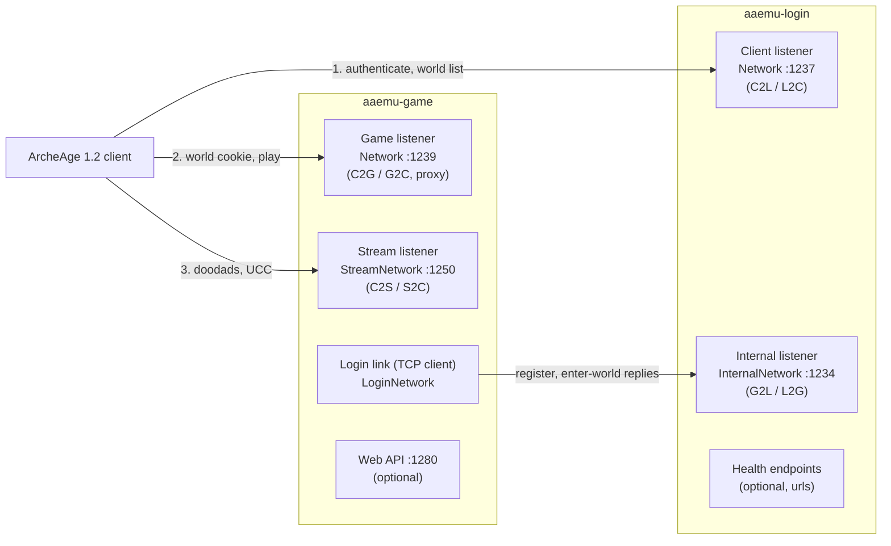
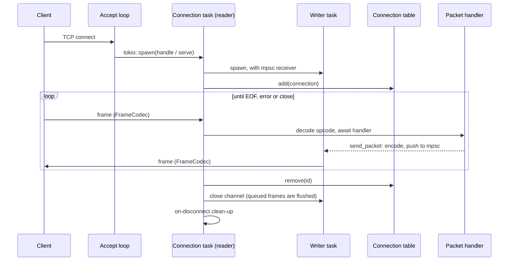
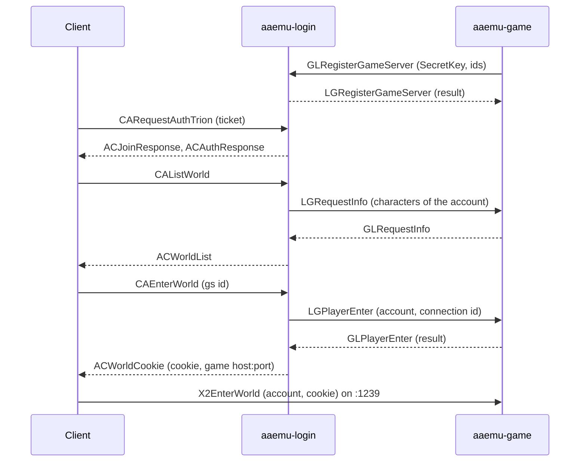

# Networking

This document describes the TCP networking of the Rust login and game servers: the listeners,
the shared framing, the per-connection tasks and the protocols spoken on each port. All network
code runs on the [tokio](https://tokio.rs/) runtime; there is no HTTP framework in the packet
path.

## Overview



| Port (default) | Server | Config section | Peer | Protocol |
| --- | --- | --- | --- | --- |
| 1237 | login | `Network` | client | C2L / L2C (`aaemu-login/src/packets/{c2l,l2c}.rs`) |
| 1234 | login | `InternalNetwork` | game servers | G2L / L2G (`aaemu-login/src/packets/{g2l,l2g}.rs`) |
| 1239 | game | `Network` | client | C2G / G2C and proxy packets (`aaemu-game/src/packets/`) |
| 1250 | game | `StreamNetwork` | client | C2S / S2C stream packets (`aaemu-game/src/stream/`) |
| 1280 | game | `WebApiNetwork` | HTTP clients | optional web API (`systems/services/webapi/`) |

A `Host` of `*` binds all IPv4 interfaces (`0.0.0.0`); any other value must be an IP address.
The game server is a TCP *client* of the login server: it connects to `LoginNetwork.Host:Port`
(which must match the login server's `InternalNetwork`).

## Framing: `aaemu_commons::net::FrameCodec`

Every protocol (C2L, G2L, game, stream) uses the same frame on the wire, implemented once as a
`tokio_util::codec` `Decoder` / `Encoder` in `rust/crates/aaemu-commons/src/net.rs`:

```text
┌──────────────────────────────┐
│ Length (u16 LE, 2 bytes)     │  size of the payload only
├──────────────────────────────┤
│ Payload (Length bytes)       │  protocol specific, see below
└──────────────────────────────┘
```

- The decoder waits until `2 + Length` bytes are buffered (reserving the missing space) and yields
  the payload without the length, so partial reads and several frames per read are handled in one
  place.
- The encoder prepends the length; a payload over 65535 bytes is rejected with
  `InvalidInput`.

Each reader wraps the socket's read half in `FramedRead<_, FrameCodec>` and each writer the write
half in `FramedWrite<_, FrameCodec>`. Payloads are parsed and built with
`aaemu_commons::PacketStream` (little-endian readers / writers, `packet_stream.rs`).

Payload layouts:

| Protocol | Payload |
| --- | --- |
| C2L / L2C, G2L / L2G | `[u16 opcode][body]` (`packets::split_opcode`) |
| Game, level 1 (C2G / G2C) | `[0xDD][0x01][hash][count][u16 opcode][body]` |
| Game, level 2 (proxy) | `[0xDD][0x02][u16 opcode][body]` |
| Stream (C2S / S2C) | `[u16 opcode][body]` |

The 1.2 protocol has no transport encryption. In level-1 game packets the server writes
`hash = 0` and `count = 0` and reads, but does not verify, the client's values
(`aaemu-game/src/net/packet.rs`).

## Connection model

All four listeners follow the same pattern:

1. An accept loop (`TcpListener::accept`) spawns one tokio task per connection and sets
   `TCP_NODELAY`.
2. The socket is split (`into_split`). The **reader / dispatcher** runs in the connection task:
   it reads frames from `FramedRead`, decodes the opcode and awaits the handler, so the packets of
   one connection are handled strictly in order.
3. A separate **writer task** owns `FramedWrite` and drains an unbounded `mpsc` channel of encoded
   payloads. Sending a packet from anywhere means encoding it and pushing the bytes into that
   channel; it never blocks on the socket, and the channel keeps the global send order.
4. The connection is registered in a table (`DashMap`) under its id, so other tasks can reach it.
5. When the reader ends (EOF, read error, a close request or server shutdown) the connection is
   removed from the table, the writer is allowed to flush what was queued, and session clean-up
   runs.



Read errors and EOF are normal disconnects and are logged at `debug`; unknown opcodes are logged
at `error` with a hex dump of the body and the connection stays open.

## Login server (`aaemu-login`)

Started by `server::run` (`rust/crates/aaemu-login/src/server.rs`): after the database check and
SQL updates it binds the internal listener, then the client listener, and runs both until the
`CancellationToken` passed to `run` is cancelled (Ctrl+C). Code: `src/network/`.

### Client connections (`network/login.rs`)

- `LoginConnection` combines the C# `LoginConnection` and `LoginSession`: a connection id rented
  from `SimpleIdManager` (returned when the last reference drops), the remote IP, whether the
  client connected from the server's own machine (local address == remote address), the outgoing
  `mpsc` sender, a `CancellationToken` for closing, and the session state behind mutexes.
- Session states: `Connected` → `Authenticating` → `Authenticated` → `EnteringWorld`
  (→ `Disconnected`). Authentication flows (`CARequestAuth*`, challenges, OTP / PC certificate /
  ARS prompts) live in `src/auth/`; the 1.2 Trion client logs in with `CARequestAuthTrion`, the
  XML ticket that `aaemu-launcher` hands to the client.
- `dispatch_messages` decodes each frame into `C2lPacket` and awaits `handlers::handle_c2l`
  sequentially.
- The writer task flushes packets that were queued before a close (for example a final
  `ACLoginDenied`) before it stops.
- `LoginConnectionTable` (`DashMap<ConnectionId, Arc<LoginConnection>>`) holds the live
  connections.

### Game server connections (`network/internal.rs`)

- `InternalConnection` is one game server link: a session id, the remote IP, the registered game
  server id (set by `GLRegisterGameServer` after the `SecretKey` check) and the outgoing channel.
- Frames are decoded into `G2lPacket` and handled by `handlers::handle_g2l`.
- When the link drops, the game server and its mirrors lose their connection in the game
  controller (shown as offline in the world list) and the link is removed from
  `InternalConnectionTable`.

### Entering the world



`initiate_enter_world` sends `LGPlayerEnter` and spawns a background task that waits for the
game server's answer with the configured enter-world timeout; it then sends `ACWorldCookie` or
`ACEnterWorldDenied`. The cookie is the login connection id. `ACWorldCookie` carries the address
from `GameServers[].Host` / `Port`, except that a client connected from the login server's own
machine gets its own address.

### Health endpoints (`health.rs`)

When the `urls` setting (or the `ASPNETCORE_URLS` environment variable, still accepted for
compatibility) lists HTTP URLs, the login server serves `/health/live` and `/health/ready` on
their ports for orchestrators and container health checks.

## Game server (`aaemu-game`)

`main.rs` starts the networks after all subsystems are loaded: `net::listener::run` (game port),
`stream::listener::run` (stream port) and `login::run` (login link), then the hosted services
(web API, Discord bot). The process exits on Ctrl+C or when a listener fails.

### Game connections (`src/net/`)

| File | Content |
| --- | --- |
| `listener.rs` | Accept loop and `serve`: the per-connection reader / dispatcher, the writer task, `on_disconnect` |
| `connection.rs` | `GameConnection` (state owned by the connection task), `ConnectionHandle`, `ConnectionTable`, `ConnCommand` |
| `packet.rs` | Frame header (`0xDD`, level, hash, count, opcode), `encode` / `decode_frame`, `ServerPacket` |
| `registry.rs` | Packet registry keyed by `(level, opcode)`; `ClientPacket` (`read` + `handle`) |

- The connection task **owns** its `GameConnection` (account, characters, active character, game
  state, logout timer), so handlers get `&mut GameConnection` without locks.
- Other tasks hold a cloneable `ConnectionHandle` from the `ConnectionTable`. `handle.send(packet)`
  encodes immediately and pushes into the same writer channel as the connection's own sends, so the
  order of all sends is kept. Requests that need the connection state (`Close`, `LeaveWorld` when
  the logout timer expires, `DetachAndClose`) are `ConnCommand`s on a second channel that the
  connection task `select!`s together with the socket.
- `GameServer::handle_frame` (`server.rs`) decodes the header, looks the handler up in the
  registry (level 1 = game packets, level 2 = proxy packets such as `PingPacket`), and logs handlers
  that take longer than 250 ms. A handler error closes the connection, like the C#
  `OnReceive` catch-all.
- Packets with the placeholder opcode `0xFFF` (no 1.2 equivalent) are dropped when sent.
- `systems::services::accounts` closes account connections that sent no `PingPacket` for 30 s
  (the real client pings on its own).
- On disconnect: the account is removed, the character leaves the world
  (`world::session::on_disconnect`), the stream token is removed and the account's login time is
  updated.
- `RUST_LOG=aaemu_game::net=debug` logs every packet (`GamePacket: C->S ...` / `S->C ...`).

### Stream connections (`src/stream/`)

The client opens a second connection to the stream port (sent in `X2EnterWorldResponse`) and joins
it with `CTJoin(accountId, cookie)`, where the cookie is its game connection id registered during
`X2EnterWorld`. The stream carries doodad cell streaming and UCC (crest / emblem) uploads and
downloads.

- `listener.rs` is the same reader + writer task pattern; `StreamConnection` (owned by the task)
  holds the doodad request table and the linked game connection, and `StreamConnectionHandle` /
  `StreamCommand` give other tasks access.
- `protocol.rs` generates the dispatcher from the list of C2S packet types; opcodes are in
  `opcodes.rs` (`CT*` client to server, `TC*` server to client).
- Game-world lookups go through the `StreamWorld` hook (`world.rs`, implemented in
  `stream_world.rs`).

### Login link (`src/login/`)

- `login::run` connects to `LoginNetwork.Host:Port`, sends `GLRegisterGameServer` (secret key,
  server id, additional ids) and reconnects 5 s after the link drops or a connect fails.
- One task `select!`s the incoming frames (`LoginInPacket`: register result, player enter,
  reconnect, request info), the outgoing channel (`LoginLink::send` from any task) and a 60 s
  interval that reports the server load (`GLGameServerLoad`).
- A refused registration closes the link.

## Configuration

| Server | Keys |
| --- | --- |
| Login | `Network.Host` / `Port` (clients), `InternalNetwork.Host` / `Port` (game servers), `GameServers[]` (world list and the address handed to clients), `SecretKey`, `urls` |
| Game | `Network.Host` / `Port`, `StreamNetwork.Host` / `Port`, `LoginNetwork.Host` / `Port`, `SecretKey`, `Id` / `AdditionalesId`, `Network.NumConnections` (load level) |

`SecretKey` must match on both servers. For LAN or remote clients, set `GameServers[].Host` to an
address the client can reach and bind the game and stream listeners to `*` or that address. See
[Working with the Config.json files and server listings](wiki/Working-with-the-Config.json-files-and-server-listings.md).

## Testing

- Unit tests next to the code cover the codec (`aaemu-commons/src/net.rs`), the frame headers,
  the packet tables and the login connection (`aaemu-login/src/network/login/tests.rs`).
- `aaemu-testclient` speaks the client side of these protocols for live tests and load tests
  (`rust/LIVE-TESTING.md`).
- `aaemu-launcher` starts the real 1.2 client against a local login server;
  `aaemu-clientdriver` drives it through Lua (`rust/docs/client/LUA-DRIVER.md`).

## File reference

| File | Purpose |
| --- | --- |
| `rust/crates/aaemu-commons/src/net.rs` | `FrameCodec` (u16 length framing) |
| `rust/crates/aaemu-commons/src/packet_stream.rs` | `PacketStream` reader / writer |
| `rust/crates/aaemu-login/src/server.rs` | Login startup, listeners, health endpoints, shutdown |
| `rust/crates/aaemu-login/src/network/login.rs` | Client listener, `LoginConnection` / session, `LoginConnectionTable` |
| `rust/crates/aaemu-login/src/network/internal.rs` | Game server listener, `InternalConnection`, `InternalConnectionTable` |
| `rust/crates/aaemu-login/src/handlers.rs` | C2L and G2L dispatch |
| `rust/crates/aaemu-login/src/packets/` | C2L, L2C, G2L, L2G packets and opcodes |
| `rust/crates/aaemu-game/src/net/` | Game listener, connections, frame header, packet registry |
| `rust/crates/aaemu-game/src/server.rs` | `GameServer::handle_frame` |
| `rust/crates/aaemu-game/src/stream/` | Stream listener, connections, packets, UCC |
| `rust/crates/aaemu-game/src/login/` | Login link (G2L / L2G) |
