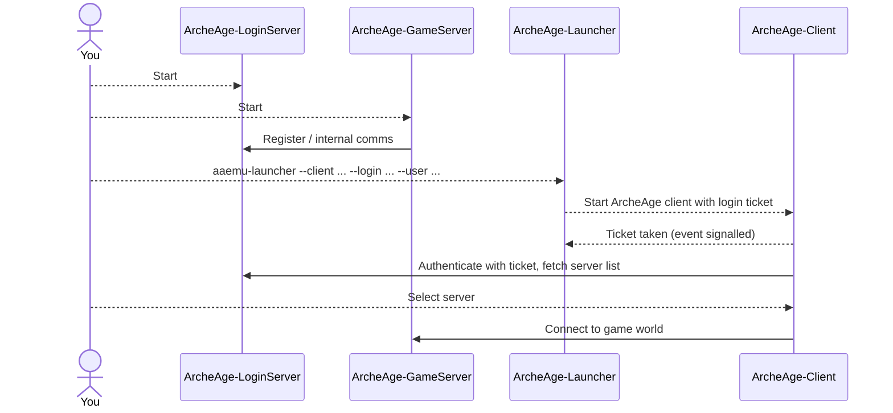

# Understanding AAEmu Components

- Audience: Contributors, players, and testers
- Last verified against: `develop` on October 10, 2026
- Prerequisites: None

Understanding the project components makes setup and debugging much easier.

## Data components

### ArcheAge reference database (SQLite, read-only)

This is the reference game data used by the server at startup.

### ArcheAge state database (MySQL, read/write)

This stores mutable game state.

It uses two schemas:

1. `aaemu_game`: world and character state.
1. `aaemu_login`: account/login state.

## Application components

### `cargo xtask dev` (optional orchestration)

`cargo xtask dev` is the preferred contributor workflow for local development.
It starts MySQL in Docker, then
the login server and the game server, and injects runtime configuration
through environment variables.

It does not replace login/game components. It orchestrates them.

### Login server

Handles authentication and server listing for clients (`aaemu-login`, Rust).

Listens on port `1237` for clients and `1234` for game server registration.

### Game server

Main world simulation process (`aaemu-game`, Rust).
Uses reference data (SQLite) and mutable state (MySQL).

Listens on port `1239` (game), `1250` (stream) and `1280` (web API).

### Game launcher (`aaemu-launcher`)

Starts the ArcheAge client against a chosen login server. The 1.2 client does
not ask for credentials itself: `aaemu-launcher` (`rust/crates/aaemu-launcher`)
puts an encrypted login ticket (user name and SHA-256 password hash) into an
inherited Windows file mapping and starts `bin32/archeage.exe` with the login
server address and the mapping handle. See [Client](Client#launcher-aaemu-launcher).

### Lua client driver (developers)

`aaemu-clientdriver` (`rust/crates/aaemu-clientdriver`) loads a small driver DLL
into a running client and runs Lua in the client's script states, so tools can
read client state and trigger UI actions (login, character select, movement,
chat) without screenshot automation. Not needed to play.

### ArcheAge client

Playable client used for testing and gameplay.

AAEmu `develop` targets client 1.2 (`r208022`).

## How components interact

## Related

- [Home](Home)
- [Local Development Guide](Local-Development-Guide)
- [Installation & Setup](Installation-&-Setup)
- [Working with the Config.json files and server listings](Working-with-the-Config.json-files-and-server-listings)
