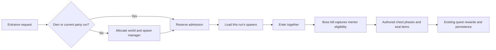

# Dungeons and Mentoring

- Audience: Players, server operators, and contributors
- Last verified against: local `rust-rewrite` implementation on October 13, 2026
- Prerequisites: Target 1.2 client data and the dungeon world spawn files

## Playing together and starting fresh

Form a party and use the dungeon entrance. The first player creates a run; the other party
members enter that same run. Another party, or an unrelated solo player, creates a separate
copy of the same dungeon. NPCs, doodads, room progress, and mentor chests belong to that copy.

`/dungeon status` lists your dungeon bindings, the **zone id** needed for reset, and the number
of players inside. `/dungeon reset <zone id>` resets a solo owner's run or the party leader's
run after everyone has left. Loading and pending entry also block reset. Use the entrance
again to create a fresh run; all party bindings to the old run are removed together.

| Dungeon | Reset command |
| --- | --- |
| Burnt Castle Armory | `/dungeon reset 168` |
| Hadir Farm | `/dungeon reset 169` |
| Palace Cellar | `/dungeon reset 170` |
| Sharpwind Mines | `/dungeon reset 184` |

Entry limits still apply to fresh runs. A character's first admission consumes one configured
entry item and one attempt; returning to the same run does not charge again. Failed admission
and full dungeons do not charge. Capacity includes players waiting while the dungeon loads.
The existing entry policy permits three fresh runs per four-hour window for ordinary dungeons.
A queued admission already accepted counts as an attempt even if the player disconnects or
leaves the party before loading finishes.
Party membership is checked again when loading finishes; leaving or being kicked while queued
does not carry the player into the old party's run. A solo run can become party-owned while loading.
Run state and entry history are in memory and reset when the server restarts. Quest state and
rewards use the existing MySQL character/inventory persistence.

Instances expire after 24 hours. Destruction cancels the loader, returns occupants to their
saved main-world positions, removes the spawns and event handlers, and releases dynamic world
ids. Mirage Island and Library system instances retain their separate channel behavior.
Empty runs whose owning party has disbanded are also cleaned up by the dungeon tick.

## Mentor and mentee quests in 1.2

Accept the corresponding quests from Lucius before entering. Both players must be in the same
party, online, alive, and within the server's loot-credit range of the final boss when it dies.
The party's qualifying members are captured at that moment; arriving or accepting the quest
after the kill does not qualify for that run's chests.

| Dungeon | Mentee levels / quest | Mentor levels / quest | Reward chests |
| --- | --- | --- | --- |
| Sharpwind Mines | 18–29 / 6083 | 30–55 / 6084 | 1 |
| Palace Cellar | 18–29 / 6166 | 30–55 / 6167 | 1 |
| Burnt Castle | 31–39 / 6087 | 40–55 / 6088 | 2 |
| Hadir Farm | 31–39 / 6169 | 40–55 / 6168 | 2 |

The mentor opens the first seal. The mentee opens the second seal and collects their seal
item. The selected mentor then collects their seal item. Each chest serves one pair; one
mentor can unlock both chests for two mentees if their quest remains active. The existing
quest engine exchanges seal items for **one Gilda Star for the mentee** and **three for the
mentor**. These quests reset through the existing daily quest reset and login checks.

Level and active quest requirements are checked again at each interaction. A mentee who
levels past the permitted range before opening their seal cannot collect it. Another player
cannot replace a selected participant or skip phases. If inventory is full, the selected
player can retry collection without consuming the chest reward.

## Implementation and evidence



`rust/crates/aaemu-game/src/systems/instances/` owns run creation, binding selection,
admission, reset, cleanup, and mentoring. Selection/creation requests are serialized to
prevent simultaneous party requests from creating two runs. Each dungeon serializes
admission and destruction; loader awaits do not hold those locks. Dynamic world creation
enforces `World.MaxInstances` at allocation.

`mentoring.rs` contains explicit 1.2 bindings verified against `compact.sqlite3`:
`quest_contexts`, `quest_components`, `unit_reqs`, `quest_act_obj_item_gathers`,
`quest_act_supply_items`, and the chest `doodad_func_*` tables. The actual NPC variants in
`app/Data/Worlds` identify the final bosses. Existing authored chest positions are used when
available; missing chests use the original template at the defeated boss, with two chests
placed two metres apart. This fallback and the eligibility snapshot are emulator behavior,
not claimed as a byte-for-byte reverse engineering of the native server.

Research corroborated the seal order in the first-party [ArcheAge Classic quest
description](https://aa-classic.com/database/quests/6167) and the original-era dungeon
descriptions for [Palace Cellar](https://archeage.fandom.com/wiki/Palace_Cellar) and
[Hadir Farm](https://archeage.fandom.com/wiki/Hadir_Farm). Version-specific levels, quest IDs,
seal items, and rewards come from the local 1.2 data rather than later versions' guides.

Verification covers simultaneous entry, separate parties, loading capacity, re-entry,
ticket consumption, leader resets, loader cancellation, duplicate death signals, late
arrivals, role/level checks, phase skipping, failed item grants, and reward replay. Tests also
reject delayed boss events from a removed run when world or NPC ids are recycled. The gated
`real_mentor_chest_seals_complete_daily_quests_and_award_gilda` test uses the actual compact
tables and inventory/quest bridges. Run it from `rust/` with `AAEMU_COMPACT_DB` pointing to
`crates/aaemu-game/app/Data/compact.sqlite3`.

```sh
cargo test -p aaemu-game systems::instances --lib
cargo test -p aaemu-game real_mentor_chest -- --ignored
```

## Related

- [Components](Components)
- [Developer Notes](Developer-Notes)
- [Local Development Guide](Local-Development-Guide)
